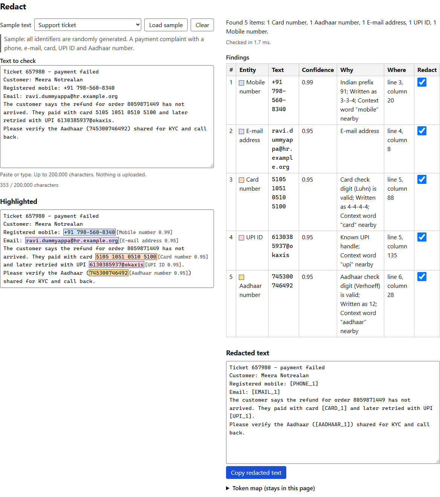
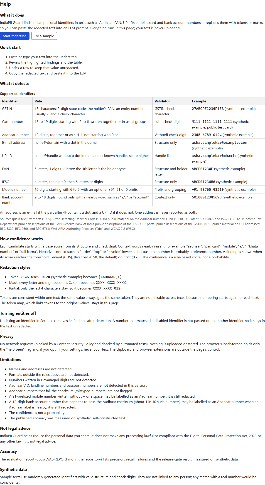
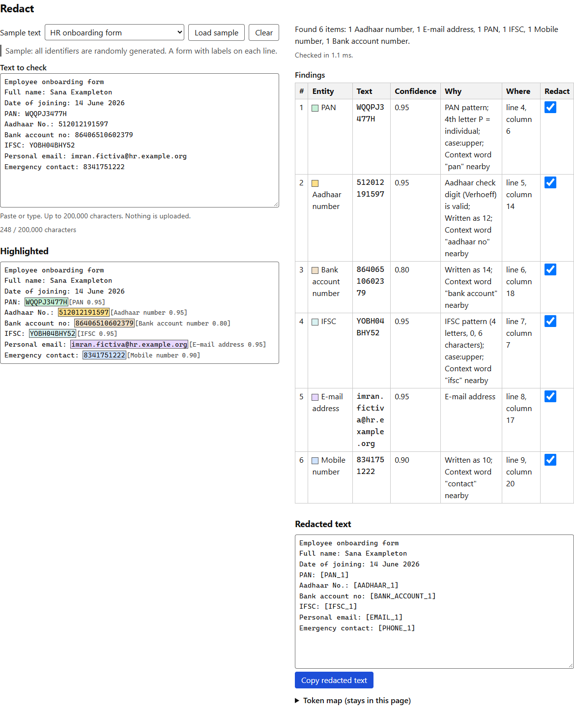
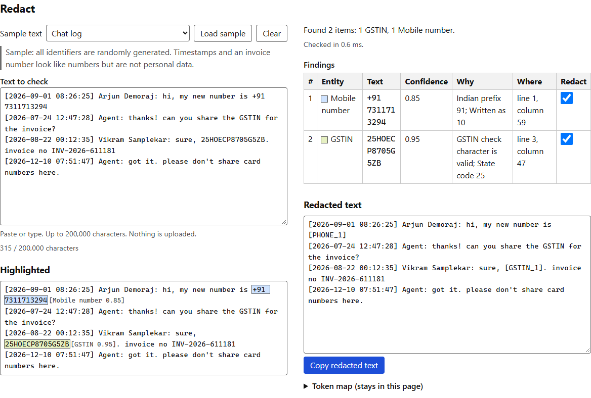
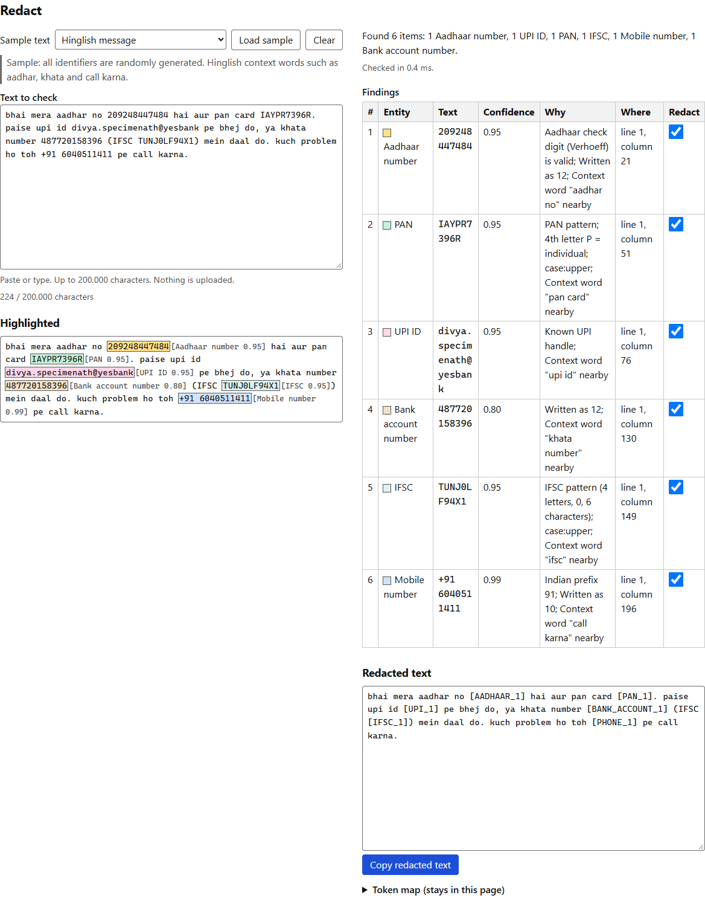
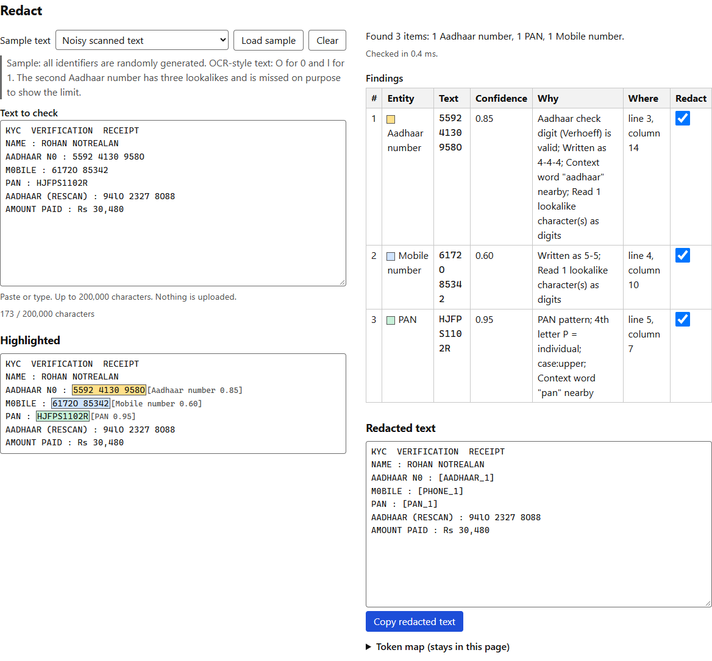
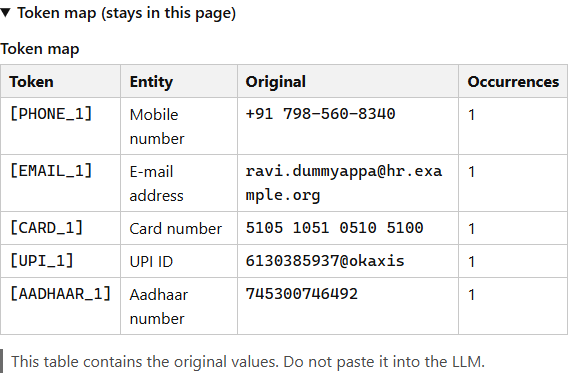
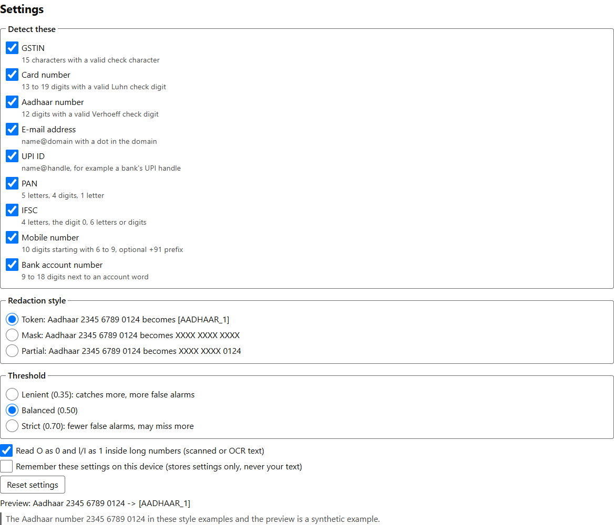

# IndiaPII Guard

Find and redact Indian personal data (Aadhaar, PAN, UPI, phone, cards, bank details) before text goes into an LLM prompt. Runs in your browser; nothing is uploaded.



*The sample data in this screenshot is synthetic: every identifier was randomly generated.*

## Live demo

Live demo: https://anirudhkaushik0211.github.io/indiapii-guard/

## Contents

- [What it does and why](#what-it-does-and-why)
- [Accuracy at a glance](#accuracy-at-a-glance)
- [Use it online](#use-it-online)
- [Screenshots](#screenshots)
- [Use it offline](#use-it-offline)
- [Deploy your own copy on GitHub Pages](#deploy-your-own-copy-on-github-pages)
- [What it detects](#what-it-detects)
- [How it works](#how-it-works)
- [Redaction styles](#redaction-styles)
- [Evaluation](#evaluation)
- [Privacy](#privacy)
- [Limitations](#limitations)
- [Not legal advice](#not-legal-advice)
- [Synthetic data](#synthetic-data)
- [FAQ](#faq)
- [For developers](#for-developers)
- [License](#license)

## What it does and why

People paste support tickets, HR forms, chat logs and scanned text into LLM prompts every day. That text often carries Aadhaar numbers, PAN, UPI IDs, mobile numbers, card numbers and bank details. Most general-purpose PII tools are built around other countries' formats, so Indian identifiers slip through.

IndiaPII Guard finds those identifiers and replaces them with tokens or masks before you share the text. It comes in three forms:

- a web page that runs entirely in your browser, online or from a downloaded folder;
- a small JavaScript library (`js/guard.js`) for Node and the browser;
- a command-line tool (`scripts/redact.cjs`) for files and pipelines.

India's Digital Personal Data Protection Act, 2023 and the Digital Personal Data Protection Rules, 2025 make careful handling of personal data an obligation for many organisations, with the main duties phased in over the following months. This tool helps reduce what you share; it is not legal advice.

## Accuracy at a glance

<!-- eval:start -->
Measured on the synthetic held-out set (exact span match, Balanced threshold). See docs/EVAL-REPORT.md for method, failures and limitations.

| Entity | Precision | Recall | F1 | Support |
|---|---|---|---|---|
| GSTIN | 100.0% | 100.0% | 100.0% | 150 |
| CARD | 100.0% | 100.0% | 100.0% | 150 |
| AADHAAR | 100.0% | 100.0% | 100.0% | 150 |
| EMAIL | 100.0% | 100.0% | 100.0% | 150 |
| UPI | 100.0% | 95.3% | 97.6% | 150 |
| PAN | 100.0% | 100.0% | 100.0% | 150 |
| IFSC | 100.0% | 100.0% | 100.0% | 151 |
| PHONE | 100.0% | 93.4% | 96.6% | 151 |
| BANK_ACCOUNT | 93.0% | 88.0% | 90.4% | 150 |
| Micro average | 99.2% | 97.4% | 98.3% | 1352 |

Release gate: PASS (27 of 27 criteria met).
<!-- eval:end -->

This PASS came on the second held-out run. Held-out run 1 failed (22 of 27 criteria at the time, 24 of 27 once browser latency was measured). Four rule changes were then made using development and adversarial evidence only, and held-out run 2 passed 27 of 27, with 2 of the 3 allowed held-out runs used. Held-out run 1 results were visible when choosing what to fix, so run 2 is not fully blind, and the adversarial set informed three of the rules, so its results are no longer unseen data. See the Development history in [docs/EVAL-REPORT.md](docs/EVAL-REPORT.md).

These numbers come from synthetic text generated by this project. They show how the rules handle the formats and contexts we wrote, not how they will do on your data. Read the evaluation report for failures and limitations.

## Use it online

1. Open the live demo. The Help tab opens on your first visit and explains the tool in a few lines.
2. Choose "Try a sample" (or "Start redacting") to go to the Redact tab.
3. Paste or type your text. Detection runs as you type.
4. Review the highlighted findings and the table. Each row says why the value was flagged. Untick a row to keep that value unredacted.
5. Choose "Copy redacted text" and paste the result into the LLM.

The Settings tab lets you turn identifier types on or off, pick a redaction style and a threshold, and switch OCR lookalike reading on or off.

## Screenshots



Synthetic sample data.


Synthetic sample data.



Synthetic sample data.



Synthetic sample data.



Synthetic sample data.



Synthetic sample data.



Synthetic sample data.



Synthetic sample data.

## Use it offline

1. Download the ZIP from the repository's Releases page (or use Code > Download ZIP).
2. Extract it. Windows: right-click > Extract All. macOS: double-click the file. Linux: use your archive tool.
3. Double-click `index.html`.

It works without an internet connection. Nothing needs to be installed.

## Deploy your own copy on GitHub Pages

1. Create a new repository on GitHub.
2. Add file > Upload files: upload the files of this project, 100 files or fewer per upload. Your file browser may hide `.nojekyll`; if it did not arrive, create it with Add file > Create new file (it is empty).
3. Settings > Pages: choose Deploy from a branch, branch `main`, folder `/ (root)`, and save.
4. Wait 1-2 minutes for the green check.
5. Your copy is at `https://<your-user-name>.github.io/<repository-name>/`.

## What it detects

| Identifier | Rule | Validator | Context examples | Confidence notes |
|---|---|---|---|---|
| GSTIN | 15 upper-case characters: 2-digit state code, the holder's PAN, an entity number, usually Z, a check character | GSTIN check character and state code | gst, gstin, gst no | 0.95 with Z in the 14th place, 0.85 otherwise |
| Card number | 13 to 19 digits starting with 2 to 6, together or in usual groups (4-4-4-4, 4-6-5 and similar) | Luhn check digit | card, debit card, cvv, rupay | 0.85, 0.95 with context |
| Aadhaar number | 12 digits, together or as 4-4-4, not starting with 0 or 1 | Verhoeff check digit | aadhaar, aadhar, uid, आधार | 0.80, 0.95 with context |
| E-mail address | A name, then @, then a domain that has a dot and ends in letters | Structure only | (none needed) | 0.95 |
| UPI ID | A name, then @, then a handle with no dot | Known handle list | upi, upi id, vpa, gpay, paytm | known handle 0.90, unknown handle 0.45 (0.85 with context) |
| PAN | 5 letters, 4 digits, 1 letter; the 4th letter is the holder type | Structure and holder letter | pan, pan card, पैन | upper case 0.85; mixed case needs context |
| IFSC | 4 letters, the digit 0, then 6 letters or digits | Structure only | ifsc, ifsc code, neft, rtgs | upper case 0.80; mixed case needs context |
| Mobile number | 10 digits starting with 6 to 9, with an optional +91, 91, 0091 or 0 prefix | Prefix and grouping | mobile, phone, whatsapp, call karna, फोन | 0.45 to 0.85 by prefix and grouping; context adds 0.20 |
| Bank account number | 9 to 18 digits | Context only (no public checksum) | a/c, account no, khata number, खाता | 0.30, so it is reported only with context (0.80) |

An address is an e-mail if the part after @ contains a dot, and a UPI ID if it does not. One address is never reported as both.

Threshold presets: Lenient (0.35) catches more and gives more false alarms; Balanced (0.50) is the default; Strict (0.70) gives fewer false alarms and may miss more.

Turning entities off: unticking an identifier in Settings removes its findings after detection. A number that matched a disabled identifier is not passed on to another identifier, so it stays in the text unredacted.

Synthetic examples used in this README, the Help tab, the SPEC and the tests:

| Identifier | Example |
|---|---|
| Aadhaar | `2345 6789 0124` (synthetic example) |
| PAN | `ABCPE1234F` (synthetic example) |
| Mobile | `+91 98765 43210` (synthetic example) |
| E-mail | `asha.samplekar@example.com` (synthetic example) |
| UPI ID | `asha.samplekar@okaxis` (synthetic example) |
| IFSC | `ABCD0123456` (synthetic example) |
| Bank account | `50100012345678` (synthetic example) |
| Card | `4111 1111 1111 1111` (synthetic example; a public test card number) |
| GSTIN | `27ABCPE1234F1ZB` (synthetic example) |

## How it works

Digit chains and boundaries. The detector reads runs of digits joined by single spaces or hyphens as one "chain" and records its grouping (for example 4-4-4). Each numeric identifier looks only at whole chains. A chain glued to a letter, `@` or `_`, a decimal point, an invoice prefix such as `INV-` or a rupee sign is ignored, which removes most amounts and reference numbers before any scoring.

Checksums. Three identifiers carry a public check digit:

- Aadhaar uses the Verhoeff check digit. It is computed with the multiplication table of the dihedral group of order 10 and a fixed permutation, so it catches every single-digit mistake and every swap of two neighbouring digits.
- Card numbers use the Luhn check digit: double every second digit from the right, subtract 9 from any result above 9, add everything up; the total must end in 0. It catches all single-digit mistakes and most neighbouring swaps (not 09 and 90).
- GSTIN uses a check character over its first 14 characters: each character becomes a number from 0 to 35, every second value is multiplied by 2, the two base-36 digits of each product are added, and the check character is the value that brings the sum to a multiple of 36.

PAN, IFSC and bank account numbers have no public checksum, so they rely on structure and context.

Context and negative context. Words near a candidate change its score. Own context, such as "aadhaar no", "mobile", "a/c" or Hinglish phrases like "call karna" and "khata number", raises it. Negative context such as "order", "otp", "utr", "invoice" or "rs" lowers it by 0.40, because the number is probably a reference or an amount. Context counts up to 48 characters before and 24 after a value; negative context counts up to 24 before and 12 after. When negative context comes before a value, own context after it is treated as the label of the next value and does not count (for example "order <number> ... card <number>").

v1.0.0 deviates from SPEC 3.6 and 3.7 (docs/SPEC.md) in four context rules: two extra negative-context words, five extra UPI payment words and the rule above. They are listed in [eval/HISTORY.md](eval/HISTORY.md) under held-out run 2.

Competing context. If the only nearby label on the same line belongs to a different numeric identifier (for example "mobile" next to a 12-digit number), the score drops by 0.15. Labels on other lines do not compete, because forms put each field's label on its own line.

OCR lookalikes. Scanned text often has the letter O for zero and l or I for one. Inside long digit runs these letters are read as digits, at most two per value, and each such finding loses 0.10 and says so in the table. A run next to other letters, or with fewer than 6 real digits, is left alone.

Confidence. Every candidate starts from a base score for its structure, then context adjusts it, and the result is capped at 0.99. A finding is shown when its score reaches the threshold. The score is a rule-based number, not a probability.

Overlap resolution. When candidates overlap, the longer span wins, then the higher score, then a fixed priority order (GSTIN, card, Aadhaar, e-mail, UPI, PAN, IFSC, mobile, bank account). So a PAN inside a GSTIN is never reported separately.

Sources: J. Verhoeff, *Error Detecting Decimal Codes*, Mathematical Centre Tracts 29, Mathematisch Centrum, Amsterdam, 1969 ([CWI repository](https://ir.cwi.nl/pub/13045/13045D.pdf)); [UIDAI, About Aadhaar](https://uidai.gov.in/en/about-aadhaar) (the 12-digit Aadhaar number); H. P. Luhn, Computer for verifying numbers, [US Patent 2,950,048](https://patents.google.com/patent/US2950048A/en) (1960), and ISO/IEC 7812-1; Income Tax Department, [How PAN is formed](https://www.incometaxindia.gov.in/w/how-pan-is-formed-and-how-it-gets-its-unique-identity-) (4th character holder status, 5th character initial); Reserve Bank of India, public descriptions of the IFSC (11 characters: 4-letter bank code, 0, 6-character branch code); Goods and Services Tax Network / GST portal, public descriptions of the GSTIN structure; National Payments Corporation of India, public material on UPI virtual payment addresses; [RFC 5322](https://www.rfc-editor.org/rfc/rfc5322) (e-mail syntax, simplified here), [RFC 2606](https://www.rfc-editor.org/rfc/rfc2606) and [RFC 6761](https://www.rfc-editor.org/rfc/rfc6761) (reserved names); E. B. Wilson (1927), Probable inference, the law of succession, and statistical inference, *Journal of the American Statistical Association* 22, 209-212; the [mulberry32 PRNG](https://gist.github.com/tommyettinger/46a874533244883189143505d203312c) (Tommy Ettinger, public domain); the W3C [WAI-ARIA Authoring Practices Tabs pattern](https://www.w3.org/WAI/ARIA/apg/patterns/tabs/) and [WCAG 2.2](https://www.w3.org/TR/WCAG22/); the Digital Personal Data Protection Act, 2023 and the Digital Personal Data Protection Rules, 2025 (Ministry of Electronics and Information Technology; notified 13 November 2025), with phased timelines as described in public commentary such as Network Intelligence, [DPDP Act compliance timeline 2026-2027](https://www.networkintelligence.ai/blogs/dpdp-act-compliance-timeline-2026-2027/). Microsoft Presidio is a general-purpose alternative; its India-specific coverage was not checked here.

## Redaction styles

- Token (default): each value becomes a token such as `[AADHAAR_1]` or `[PHONE_2]`.
- Mask: every letter and digit becomes X, so `2345 6789 0124` becomes `XXXX XXXX XXXX`.
- Partial: only the last 4 characters stay, so it becomes `XXXX XXXX 0124`. For e-mail and UPI IDs, the first character and the part from @ on stay.

Consistent tokens: within one text, the same value always gets the same token, so the LLM can still tell that two mentions are the same person or account. Numbering starts again for each text, so tokens cannot be linked across texts.

Token map: the Redact tab has a collapsible token map that lists each token with its original value. It stays in the page. Do not paste it into the LLM.

## Evaluation

Datasets. Three synthetic sets are built from templates with a seeded generator: development (seed 1001), used while building the rules; held-out (seed 2002), with different sentence structures and some context phrasings the rules do not know; and adversarial (seed 3003), with noise such as OCR lookalikes, odd spacing, lower case and obfuscated addresses, plus many lookalike decoys (order numbers, UTRs, coupons). Latency inputs use seed 4004.

Matching. A finding counts as correct only if entity, start and end all match the label exactly. The report also shows overlap matching, leak rate (how much identifier text stays visible) and the share of decoys flagged.

Release gate. The 27 criteria of section 9.8 of [docs/SPEC.md](docs/SPEC.md) (per-entity precision and recall, adversarial and decoy limits, latency) were fixed before the first measurement and are never changed to fit a result. The gate result is the "Release gate" line in [Accuracy at a glance](#accuracy-at-a-glance), written by `npm run eval`; if it says FAIL, [docs/EVAL-REPORT.md](docs/EVAL-REPORT.md) lists the failing criteria and the failure examples.

Reproduce:

```
npm run eval                      # all sets; writes eval/results/, docs/EVAL-REPORT.md and the block above
npm run eval -- --write-data      # also writes the generated datasets under dist/eval-data/
```

Held-out discipline: the held-out and adversarial templates were written and frozen before any run on them, and every held-out run is recorded in [eval/HISTORY.md](eval/HISTORY.md) with a hash of the detector code. The detector is changed only for defects found on the development set, the adversarial set or unit tests, never by tuning on held-out results.

## Privacy

- No network requests (blocked by a Content Security Policy and checked by automated tests).
- No analytics and no cookies.
- Your input text is never stored.
- localStorage holds only the "help seen" flag and, if you opt in with "Remember these settings", your settings.
- The clipboard, screen sharing and browser extensions are outside the page's control. A copied text may stay in your clipboard history.

## Limitations

- Names and addresses are not detected (there is no named-entity model in v1).
- Formats outside the rules above are not detected.
- Numbers written in Devanagari digits are not detected.
- Aadhaar VID, landline numbers, passport numbers and dates of birth are not detected in v1.
- Mistyped Aadhaar numbers (failing the checksum) are not flagged.
- A mobile number written as `91` plus 10 digits with no `+` or space that happens to pass the Aadhaar checksum (about 1 in 10) is labelled Aadhaar instead of mobile; it is still redacted.
- A 12-digit bank account number that happens to pass the Aadhaar checksum (about 1 in 10 such numbers) may be labelled as an Aadhaar number when an Aadhaar label is nearby; it is still redacted.
- The PAN check letter and bank account numbers have no public checksum, so they rely on structure and context.
- The UPI handle list is not exhaustive; unknown handles need context such as "upi".
- The confidence is a rule-based score, not a probability.
- Text only: images, PDFs and scans must be converted to text first.
- All accuracy numbers were measured on synthetic data.

## Not legal advice

IndiaPII Guard helps reduce the personal data you share. It does not make any processing lawful or compliant with the Digital Personal Data Protection Act, 2023 or any other law. It is not legal advice. It is not a compliance certification.

## Synthetic data

All identifiers in samples, tests and evaluation data are randomly generated with valid structure and check digits. They are not linked to any person; any match with a real number would be coincidental. Card numbers are publicly documented test numbers. E-mail addresses use reserved example domains.

## FAQ

**Does my text leave the browser?** No. The page makes no network requests; a Content Security Policy blocks them and automated tests check it. Detection runs in the page.

**Why was my number not detected?** It may be in a format outside the rules, fail its checksum, have a word glued to it, or score below the threshold (bank accounts need a nearby word such as "a/c"). Try the Lenient threshold and check the Limitations.

**Why was an order number flagged?** Some reference numbers pass the same checksums as real identifiers. Words such as "order" or "utr" lower the score, but without them the number can look real. Untick the row to keep it.

**Why is an e-mail-looking address shown as a UPI ID?** If the part after @ has no dot (for example `asha.samplekar@okaxis`, a synthetic example), it is treated as a UPI ID.

**Why does it not detect names?** Names need a language model, not rules. v1 is rules and checksums only, so names and addresses stay in the text.

**Can I map tokens back?** Yes, with the token map in the page. It stays in the page; keep it out of the prompt.

**Why are the tokens not the same across two texts?** Numbering starts again for each text, so tokens from different texts cannot be linked.

**Is a confidence of 0.95 a 95% probability?** No. It is a rule-based score used to sort and filter findings.

**Is this DPDP compliant?** The tool cannot make anything compliant. It helps you share less personal data; see "Not legal advice".

**Can I use it in my pipeline?** Yes. Use the library in Node or the browser, or the CLI with `--fail-on-find` to stop a pipeline when something is found.

**Why classic scripts instead of modules?** Browsers block ES modules on `file://` pages, and the page must work when you double-click `index.html`. Each file uses a small wrapper so it also works with `require` in Node.

## For developers

File layout:

```
index.html, css/app.css      the page
js/                          validators, lexicon, detector, redactor, guard (public API), prng, synth, samples, ui
scripts/                     redact.cjs (CLI), eval, bench-browser, serve, browser drivers, ui-smoke,
                             capture-screenshots, denylist, selfscan, zip, package-public
eval/                        templates, dataset builder, metrics, release gate, report, HISTORY.md, results/
test/                        unit tests (node:test)
docs/                        PRD, SPEC, EVAL-REPORT, CASE-STUDY, THREAT-MODEL, screenshots
```

Library API (section 6.1 of the SPEC):

```js
// Node
const guard = require('./js/guard.js');
const r = guard.redact('PAN ABCPE1234F, mobile +91 98765 43210');
console.log(r.text);       // PAN [PAN_1], mobile [PHONE_1]
console.log(r.mapping);    // [{ key, entity, token, text, count }, ...]
const d = guard.detect('call 9876543210', { threshold: 'strict' });
// d.findings: [{ id, entity, start, end, text, value, confidence, reasons, normalised }], d.stats
```

In the browser, load the scripts in the order of `index.html` (`validators`, `lexicon`, `detector`, `redactor`, `prng`, `synth`, `samples`, `guard`); the API is on `window.IndiaPIIGuard` (`IndiaPIIGuard.redact(text, options)`). Options: `threshold` (0 to 1 or `lenient` / `balanced` / `strict`), `entities` (array of ids or `{ ID: boolean }`), `style` (`token`, `mask`, `partial`), `ocrNormalise`, `exclude` (finding keys such as `PAN:ABCPE1234F` to keep), `maxLength`. Invalid options throw a `TypeError` with a fixed message; the library never logs.

CLI (section 6.3 of the SPEC):

```
node scripts/redact.cjs <file|-> [--style token|mask|partial] [--threshold <0..1>|lenient|balanced|strict]
                        [--entities AADHAAR,PAN,...] [--no-ocr] [--json] [--out <file>] [--fail-on-find]

node scripts/redact.cjs ticket.txt                        # redacted text to stdout
node scripts/redact.cjs ticket.txt --style mask --out ticket.redacted.txt
type ticket.txt | node scripts/redact.cjs - --json        # JSON output contains the original values
node scripts/redact.cjs ticket.txt --fail-on-find         # exit 3 if anything was redacted
```

Exit codes: 0 success; 1 runtime error (missing or unreadable file, not UTF-8, larger than 10 MB); 2 invalid arguments; 3 something was found with `--fail-on-find`.

Commands:

```
npm test                                          # unit tests
npm run eval                                      # evaluation (writes results, report, README block)
npm run bench:browser                             # in-browser latency in Edge and Firefox
npm run smoke                                     # browser smoke test (Edge and Firefox)
npm run screenshots                               # docs/screenshot-*.png
node scripts/package-public.cjs --generic-only    # build dist/indiapii-guard-public/ and its zip
```

Requirements: Node 22 or later, for the tooling only. The page and the library have zero dependencies, and the tooling uses Node built-ins only. The browser scripts need Microsoft Edge and Firefox installed.

Reporting a miss: open an issue with a synthetic reproduction (build a value with the right checksum, or change digits of an example above). Never paste a real identifier into an issue.

## License

MIT, see [LICENSE](LICENSE).
